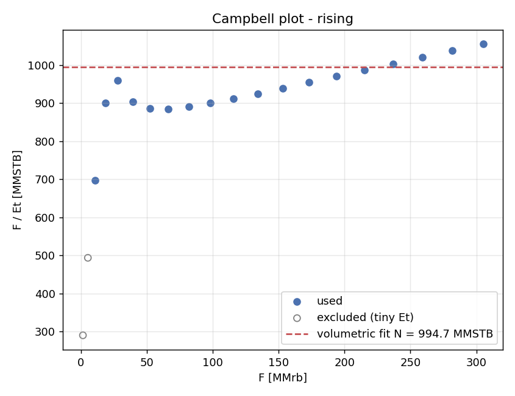

# pvtmb: black-oil PVT and material balance

A Python toolkit for two classic reservoir-engineering calculations:

1. **Black-oil PVT from correlations.** Standing, Vasquez-Beggs and Beggs-Robinson give Rs, pb, Bo, co and μo. Hall-Yarborough and Dranchuk-Abou-Kassem give the gas z-factor. Bg, gas viscosity (Lee-Gonzalez-Eakin) and water FVF (McCain) are also included.
2. **Havlena-Odeh material balance.** It estimates original oil in place (OOIP), gas-cap size and aquifer strength from a pressure/production history, then identifies the drive mechanism with a Campbell plot and Pirson drive indices.

Each correlation and solver is checked against published textbook data or against synthetic histories whose answer is known (see [Validation](#validation)).



## Install

```bash
pip install -e ".[dev]"
pytest            # unit tests + doctests
```

Requires Python 3.10+, numpy, pandas and matplotlib.

## Quick start

### Command line

```bash
# PVT table (field units) and a 4-panel figure
pvtmb pvt --api 35 --gas-gravity 0.75 --temperature 200 --rsb 600 --plot pvt.png

# same fluid specified in SI, table printed in SI
pvtmb pvt --api 35 --gas-gravity 0.75 --temperature 93.3 --temperature-unit degC \
          --rsb 106.9 --gor-unit sm3/sm3 --pressure-unit MPa --pmin 1 --pmax 35 --units si

# z-factor by both methods (with optional sour-gas correction)
pvtmb zfactor --pressure 20 --pressure-unit MPa --temperature 80 --temperature-unit degC \
              --gas-gravity 0.7 --co2 0.05

# OOIP + drive mechanism from a history CSV (PVT columns given)
pvtmb mbal examples/virginia_hills.csv --swi 0.24 --cw 3.62e-6 --cf 4.95e-6 \
           --liquid-unit mstb --plots out/

# ...or let the correlations supply PVT for a history with only t, p, Np, Gp, Wp
pvtmb mbal examples/water_drive_synthetic.csv --swi 0.22 --cw 3e-6 --cf 5e-6 \
           --liquid-unit mstb --gas-unit mmscf \
           --api 30 --gas-gravity 0.8 --temperature 180 --pb 3200 --plots out/

# re-run every textbook comparison
pvtmb validate
```

Output from the water-drive example:

```
Drive mechanism : water drive
Campbell plot   : rising (F/Et varies 38.4% across the history)
Drive indices   : DDI 0.08, SDI 0.00, WDI 0.91, EDI 0.01  (latest point)

Method      : F/Et vs W/Et (schilthuis aquifer)
OOIP N      : 90.00 MMSTB  (+/- 0.00)
Aquifer     : schilthuis, C = 60 (+/- 0.000168), We = 279.10 MMrb at last point

Models compared (R^2 of F):
  volumetric   N =    994.72 MMSTB   R^2 = 0.99323
  schilthuis   N =     90.00 MMSTB   R^2 = 1.00000
```

The volumetric model fits F with R² = 0.993 and still overstates OOIP elevenfold. A high R² alone does not validate the assumed drive mechanism. The Campbell plot shows the missing energy.

### Python

```python
import numpy as np
from pvtmb import BlackOil, MaterialBalance, identify_drive

oil = BlackOil(api=35, gas_gravity=0.75, temperature=200, rsb=600,
               correlation="vasquez_beggs", z_method="hall_yarborough")
oil.pb, oil.bo(3000), oil.mu_o(2000), oil.z(2000)
table = oil.table(np.linspace(500, 5000, 10), units_out="si")

mb = MaterialBalance(history_df, swi=0.2, cw=3e-6, cf=4e-6, fluid=oil)
mb.fit(m=0)                                  # F = N Et
mb.fit(m="estimate")                         # F/Eo vs Eg/Eo
mb.fit(m=0.3, aquifer="schilthuis")          # F/Et vs W/Et
print(identify_drive(mb).report())
```

## Methods

### PVT correlations (field units: psia, °F, scf/STB, rb/STB, cp)

| Property | Below / at pb | Above pb |
|---|---|---|
| Rs, pb | Standing (1947) or Vasquez-Beggs (1980) | Rs = Rsb |
| Bo | Standing or Vasquez-Beggs | Bob·(pb/p)^A from the VB compressibility co = A/p |
| co | apparent: −(1/Bo)(dBo/dp − Bg·dRs/dp) | Vasquez-Beggs |
| μo | Beggs-Robinson dead + live oil | Vasquez-Beggs undersaturated |
| z | Hall-Yarborough or Dranchuk-Abou-Kassem with Sutton pseudo-criticals (+ Wichert-Aziz) | same |
| Bg, μg, Bw | 0.005035 zT/p, Lee-Gonzalez-Eakin, McCain | same |

The bubble point is the algebraic inverse of each Rs correlation. For Vasquez-Beggs this is identical to the published pb form (the test suite checks this), so `Rs(pb(Rsb)) == Rsb` holds exactly.

### Material balance

The general MBE as a straight line (Havlena & Odeh, 1963):

```
F = N (Eo + m Eg + Efw) + We

F   = Np [Bo + (Rp − Rs) Bg] + Wp Bw − Winj Bw − Ginj Bg
Eo  = (Bo − Boi) + (Rsi − Rs) Bg
Eg  = Boi (Bg / Bgi − 1)
Efw = (1 + m) Boi (cw Swi + cf) / (1 − Swi) Δp
```

Each combination of unknowns gives a linear model:

| Known | Unknown | Straight line |
|---|---|---|
| m | N | F vs Et through the origin, slope N |
| — | N, m | F/E1 vs E2/E1, intercept N, slope Nm (E1 = Eo + Ef, E2 = Eg + Ef) |
| m | N, aquifer C | F/Et vs W/Et, intercept N, slope C |
| — | N, m, C | F = N·E1 + Nm·E2 + C·W (multiple regression) |

Aquifers are written as We = C·W(p, t), which keeps the problem linear. Two models are included: pot (W = Δp) and Schilthuis steady-state (W = ∫Δp dt).

### Drive-mechanism identification

`identify_drive` runs these steps:

1. **Campbell plot (F/Et vs F).** It checks the shape for the volumetric model: flat, rising, falling or hump. Points where Et is under 5% of its maximum are excluded, because there the ratio is dominated by PVT rounding.
2. **Model comparison.** If the plot isn't flat, it fits each aquifer model, plus a gas cap for initially saturated reservoirs. An alternative is kept only if it at least halves the unexplained variance of F compared with the volumetric model.
3. **Pirson drive indices.** These are computed from the chosen fit: DDI (depletion), SDI (gas cap), WDI (water), EDI (rock + connate-water expansion). They sum to 1, and the dominant index names the mechanism.

The report flags cases that production data alone can't resolve:
- **Pot aquifer vs gas cap.** Both expansion terms scale with Δp.
- **Pot aquifer above pb.** W and Et are both proportional to Δp, so the aquifer just looks like extra OOIP.

## Validation

`pvtmb validate` reproduces everything below; the full output is in [examples/output/validation.txt](examples/output/validation.txt).

### Oil correlations vs. lab data

Six crude-oil samples with measured bubble-point properties, from Ahmed, *Reservoir Engineering Handbook*, ch. 2:

| Property | Standing AARE (max) | Vasquez-Beggs AARE (max) |
|---|---|---|
| Rs at pb | 10.6% (23.2%) | 5.1% (15.1%) |
| Bob | 1.8% (5.5%) | 2.6% (5.1%) |
| pb | 8.0% (16.0%) | 4.7% (14.8%) |

These errors are within the accuracy published for these correlations. The worst sample for both is oil 6 (27.3 °API, pb = 4239 psia).

### z-factor

Hall-Yarborough and DAK are independent fits to the Standing-Katz chart. They agree to a mean of 0.30% (max 1.6%) over Tpr 1.2–3.0 and ppr 0.5–12. The largest gaps are near Tpr ≈ 1.2, ppr ≈ 2, where the chart bends most sharply. Tests also check each EOS residual at the converged root and the ideal-gas limit.

### Virginia Hills Beaverhill Lake (Ahmed, ch. 11)

This is a volumetric undersaturated reservoir: pi = 3685 psia, pb = 1500 psia, Swi = 0.24, cw = 3.62e-6 psi⁻¹, cf = 4.95e-6 psi⁻¹.

- **Expansion and withdrawal terms.** The computed F, Eo and Eo + Ew,f match the book's solution table to its printed precision.
- **OOIP.** Least squares through the origin gives **N = 283 ± 6 MMSTB**. The book reads **N ≈ 257 MMSTB** off a line drawn by eye. A least-squares fit of the book's own tabulated points also gives 284 MMSTB, so the gap comes from fitting by eye, not from the terms. The volumetric estimate is 270.6 MMSTB.
- **Drive mechanism.** Undersaturated oil expansion (DDI 0.57), with rock and connate-water expansion supplying a large share (EDI 0.42). A large EDI is typical for undersaturated reservoirs with cf ≈ 5e-6 psi⁻¹.

### Synthetic histories

`pvtmb.synthetic.synthetic_history` runs the MBE forward from a known N, m and aquifer to generate Np/Gp histories. Fitting them recovers the inputs to better than 1e-6 relative error in every case:
- undersaturated
- solution gas
- gas cap with known m
- gas cap with estimated m
- pot aquifer
- Schilthuis aquifer
- gas cap + aquifer together

With 1% multiplicative noise on Np, the gas-cap fit stays within three standard errors.

## Numerical notes

- **Root finding.** Both z-factor EOS are solved for reduced density with a Newton–Raphson iteration safeguarded by bisection (`numerics.newton_bracketed`). It uses an analytic derivative and a bracket that always contains the root: (0, 1) for Hall-Yarborough's y, and a bracket widened as needed for DAK's ρr. Convergence is guaranteed, and the rate is quadratic near the root.
- **Regression.** OLS returns coefficient standard errors. Fits through the origin report uncentred R². The error in m = (Nm)/N is propagated to first order.
- **Consistency checks.** Tests verify the following:
  - undersaturated Bo against a numerical derivative of the VB compressibility
  - Bo and μo are continuous at pb
  - Beggs-Robinson live viscosity reduces to dead-oil viscosity at Rs = 0

## Unit handling

All physics runs in oilfield units. `pvtmb.units.convert` handles conversions at the boundaries:

- pressure: psia, psig, kPa, MPa, bar, atm
- temperature: °F, °C, K, °R
- liquid volume: STB, MSTB, MMSTB, m³
- gas volume: scf, Mscf, MMscf, sm³
- GOR: scf/STB, sm³/sm³
- FVFs, viscosity, compressibility

```python
>>> from pvtmb import convert
>>> convert(20, "MPa", "psia")
2900.754754
>>> convert(100, "sm3/sm3", "scf/stb")
561.4583333482384
```

`BlackOil.from_units(...)`, `table(..., units_out="si")` and the CLI `--*-unit` flags all use this layer. Gauge pressure is handled as an offset, not a factor. Incompatible conversions (such as psia to °F) raise `UnitError`.

## Project layout

```
pvtmb/
  units.py              unit conversion layer
  numerics.py           safeguarded Newton, least squares, trapezoid integral
  correlations/
    oil.py              Standing, Vasquez-Beggs, Beggs-Robinson
    gas.py              Sutton, Wichert-Aziz, Hall-Yarborough, DAK, Bg, Lee et al.
    water.py            McCain Bw
  fluid.py              BlackOil model and PVT tables
  material_balance.py   Havlena-Odeh terms and fits
  aquifer.py            pot and Schilthuis influx functions
  diagnostics.py        Campbell plot, drive indices, identify_drive
  synthetic.py          forward MBE for known-answer histories
  datasets.py           textbook data used for validation
  validation.py         validation report
  plots.py, cli.py
examples/               input CSVs, generator script and generated outputs
tests/
```

## Limitations

- Correlations are empirical. Check that a fluid falls within each correlation's data range: Standing was built on California crudes, and Vasquez-Beggs splits its fit at 30 °API.
- Only pot and Schilthuis aquifers are included. Van Everdingen-Hurst, Carter-Tracy and Fetkovich are not yet implemented.
- Undersaturated Bo always uses the Vasquez-Beggs compressibility, whichever saturated correlation is selected.
- SI ↔ field conversion of GOR and Bg ignores the small difference between standard conditions (60 °F / 14.696 psia vs 15 °C / 101.325 kPa).

## References

- Standing, M.B. (1947). A pressure-volume-temperature correlation for mixtures of California oils and gases. *Drill. & Prod. Prac.*, API.
- Vasquez, M. & Beggs, H.D. (1980). Correlations for fluid physical property prediction. *JPT* 32(6).
- Beggs, H.D. & Robinson, J.R. (1975). Estimating the viscosity of crude oil systems. *JPT* 27(9).
- Hall, K.R. & Yarborough, L. (1973). A new equation of state for Z-factor calculations. *Oil & Gas J.*
- Dranchuk, P.M. & Abou-Kassem, J.H. (1975). Calculation of Z factors for natural gases using equations of state. *JCPT* 14(3).
- Sutton, R.P. (1985). Compressibility factors for high-molecular-weight reservoir gases. SPE 14265.
- Havlena, D. & Odeh, A.S. (1963). The material balance as an equation of a straight line. *JPT* 15(8).
- Ahmed, T. *Reservoir Engineering Handbook*. Gulf Professional Publishing.
- McCain, W.D. (1990). *The Properties of Petroleum Fluids*, 2nd ed.
